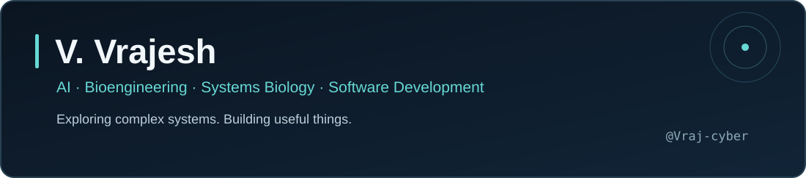
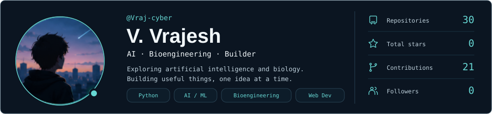
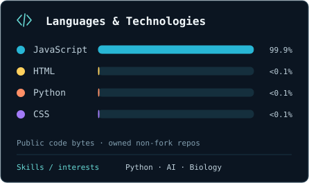
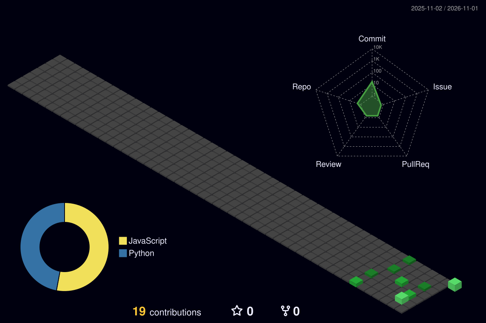

  
    
  <a href="https://github.com/Vraj-cyber?tab=repositories">Repositories</a> &nbsp;·&nbsp; <a href="https://github.com/Vraj-cyber/vvrajesh-website-">Portfolio source</a>

 

### About Me

I'm V. Vrajesh. I explore the intersection of artificial intelligence, bioengineering, and systems biology, and build useful software tools. I'm especially interested in turning complex ideas into intuitive, interactive experiences.

### Technologies and Tools

`Python` · `JavaScript` · `Git` · `GitHub` · `Web development`

Python for my ongoing assistant work; JavaScript and web development in my public projects. Always learning, building, and refining.

### GitHub at a Glance

Refreshed daily from GitHub's APIs. Stars count owned, non-fork public repositories. Contributions cover GitHub's past-year calendar; languages describe public code, not proficiency. [Data](./assets/stats.json) · [Update status](https://github.com/Vraj-cyber/Vraj-cyber/actions/workflows/profile-3d.yml)

### Contributions in 3D

Generated daily with [github-profile-3d-contrib](https://github.com/yoshi389111/github-profile-3d-contrib), using GitHub's automatically scoped token.

### Currently Building

| Project | Focus | Status |
|:--|:--|:--|
| **Nova — Personal AI Assistant** | A personal assistant combining local and cloud capabilities | Ongoing development; no public repository linked |
| **BODY//CONTROL** | Interactive systems biology learning through simulations, feedback, and play | Ongoing development; no public repository linked |
| **[Personal Portfolio Website](https://github.com/Vraj-cyber/vvrajesh-website-)** | A website bringing together my work and background | Public source available |

 

---

<a href="https://github.com/Vraj-cyber">@Vraj-cyber</a> · Build thoughtfully. Keep learning.

