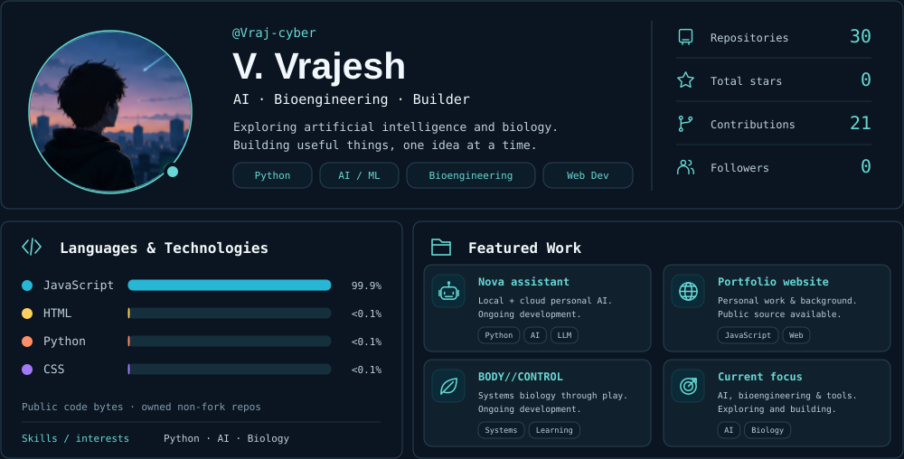

  

<a href="https://github.com/Vraj-cyber?tab=repositories">Repositories</a> · <a href="https://github.com/Vraj-cyber/vvrajesh-website-">Portfolio source</a> · <a href="./assets/stats.json">Live data</a> · <a href="https://github.com/Vraj-cyber/Vraj-cyber/actions/workflows/profile-3d.yml">Daily updates</a>

### Contributions in 3D

<!-- Dashboard is a static SVG refreshed daily by GitHub Actions.
     Metrics come from GitHub APIs; contribution geometry comes from
     yoshi389111/github-profile-3d-contrib. Stars exclude forks.
     Language shares measure bytes, not skill; tiny shares display <0.1%.
     Nova and BODY//CONTROL are ongoing work without invented repository links.
     The avatar artwork is reused from the user-supplied design reference.
     SVG image contents cannot act as interactive cards on GitHub;
     working navigation links are provided immediately below the dashboard. -->
